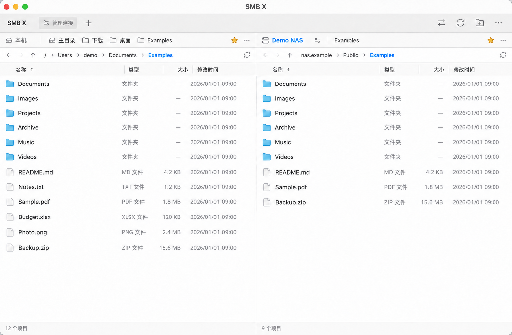

# SMB X <sub>[Homepage](https://mac.xiaolee.com/smbx/)</sub>

简体中文 | [English](README.en.md)

一个轻量、纯粹的 macOS / Windows 双栏 SMB 文件管理与传输小工具。



## 功能

- 左右双栏同屏浏览本地文件与远程 SMB 共享
- 支持上传、下载、复制、移动，直接跨栏拖拽即可传文件
- 支持按名称实时筛选当前目录，也能直接从系统 Finder / 资源管理器把文件拖进来
- 支持 SMB2/3、自定义端口、Domain 域登录和共享目录自动列出
- 常用的服务器和深层目录可以随手收藏，不用每次重新翻路径
- 内置传输队列，看得见实时进度和速度，支持中途取消、失败重试和同名文件冲突处理
- 账号密码直接交由系统原生的 macOS Keychain / Windows 凭据管理器保存
- 支持简体中文、English，默认跟随系统语言
- 基于 Tauri 2 构建，直接复用系统 WebView，不用在电脑里多塞一个臃肿的 Chromium

## 搜索与拖入

在当前文件栏直接按键盘 `A–Z`，就能直接选中并滚动到对应字母开头的文件或文件夹（不区分大小写）。连按同一个字母会按当前顺序挨个切换，没匹配到就停在原处。如果当时开着搜索筛选，就只在筛选结果里定位；在输入框里正常打字不会误触发跳转。

点每栏地址栏旁边的搜索图标，或者按 `Cmd/Ctrl + F`，可以按名字实时过滤当前目录下的内容（不区分大小写，支持部分匹配，不做子目录递归）。按 `Esc`、点关闭按钮或者切换目录都会清空筛选；过滤状态下按“全选”只会选中当前显示出来的结果，不用担心误操作被隐藏的文件。

从 Finder / Explorer 拖文件或文件夹到本机或 NAS 栏时，丢在列表空白处会复制到当前目录，丢在某个文件夹行上则会直接传进那个子目录里。支持多文件与文件夹同时拖入，原文件默认保留，遇到同名冲突会在传输队列里提示确认。目录正在读取、有弹窗遮挡，或者目标是符号链接时，默认不接收拖入以防误传。

## 下载

直接去 [GitHub Releases](https://github.com/imxiaolee/smb-x/releases/latest) 下载对应系统的最新版本即可。

| 平台 | 文件 | 安装方式 |
| --- | --- | --- |
| macOS 11+ / Apple Silicon | `.dmg` | 打开 DMG，将 `SMB X.app` 拖入 Applications |
| Windows 10/11 x64 | `.zip` | 解压后直接双击运行 `SMB X.exe`，无需安装 |

> 目前暂不提供 Intel 芯片的 Mac 版本。

### macOS 首次打开

因为目前还没有购买 Apple Developer ID 证书做签名和公证（Notarization），下载后首次打开可能会被系统的 Gatekeeper 拦截。

确认应用是从本仓库下载后，先把 `SMB X.app` 拖进 `/Applications`（应用程序），然后打开终端跑一下这行命令：

```bash
xattr -dr com.apple.quarantine "/Applications/SMB X.app"
```

移除下载隔离标记后，就能从 Finder 正常打开了，或者直接在终端运行：

```bash
open "/Applications/SMB X.app"
```

`xattr` 命令会跳过系统的下载隔离检查，请仅对确认来源可靠的应用使用。另外，macOS 首次运行时可能会请求访问桌面、文稿、下载目录或局域网权限，按实际需要点允许即可。

### Windows

Windows 版是绿色免安装版，解压 ZIP 后直接运行就行（目前同样暂未做商业代码签名）。

软件运行依赖 [Microsoft Edge WebView2 Runtime](https://developer.microsoft.com/microsoft-edge/webview2/)。Windows 11 一般已经自带；如果双击打不开，先装一下这个 WebView2 运行库就能解决。

## 校验下载

Release 页面同时提供了 `SHA256SUMS.txt`，需要校验安装包完整性的话可以跑一下哈希对比。

macOS：

```bash
shasum -a 256 <文件名>
```

Windows PowerShell：

```powershell
Get-FileHash <文件名> -Algorithm SHA256
```

算出来的结果和 `SHA256SUMS.txt` 里对应文件的哈希值一致就没问题。

## 开发

本地编译需要准备好：

- Node.js 22
- Rust stable

安装依赖并启动开发环境：

```bash
npm ci
npm run tauri dev
```

运行测试：

```bash
npm test
cargo test --locked --manifest-path src-tauri/Cargo.toml
```

macOS 下需要安装 Xcode Command Line Tools。

Windows 下构建需要安装 Visual Studio 的 **Desktop development with C++** 工作负载、Windows SDK 和 WebView2 Runtime。

## 已知限制

- 目前只打包了 Apple Silicon (M 系列芯片) 的 macOS 版本
- macOS / Windows 安装包目前都还没有做付费数字签名
- 出于安全考虑，不支持老旧的 SMB1 协议
- 暂不支持 Kerberos SSO、局域网 SMB 自动发现、文件双向同步和跨层级递归搜索

## License

本项目采用 [MIT License](LICENSE) 开源。

项目中用到的第三方组件遵循各自的开源许可证，相关许可文件会随 Release 一起打包提供。